  

<a href="https://github.com/Sherfiter/WinFontBeauty">WinFontBeauty</a> ·
<a href="https://github.com/Sherfiter/sowon-personal-windows-verison">sowon</a> ·
<a href="https://github.com/Sherfiter/slides">slides</a> ·
<a href="https://github.com/Sherfiter/Wiki">Wiki</a> ·
<a href="https://github.com/Sherfiter/todo">todo</a>

