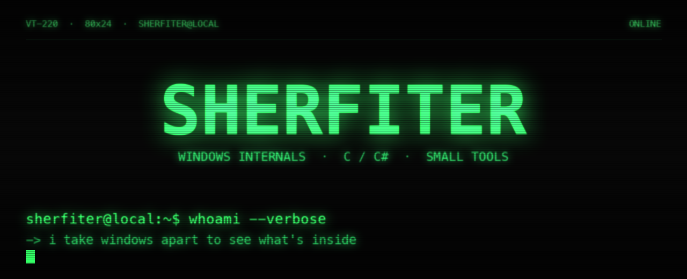

<!--
  Sherfiter / Sherfiter · 复古 TTY 主题
  banner 图在 assets/ 下，绿色是默认；想换琥珀色把下面 img 的
  tty-banner.png 改成 tty-banner-amber.png 即可。
-->

<p align="center">
  <a href="https://github.com/Sherfiter">
    
  </a>
</p>

```text
╔════════════════════════════════════════════════════════════════════════╗
║  host ..... sherfiter@local                                            ║
║  node ..... zhengzhou, cn                                              ║
║  kernel ... c / c# / python / javascript                               ║
║  focus .... windows internals . fonts . small utilities                ║
║  uptime ... still reading jyy's os course                              ║
╚════════════════════════════════════════════════════════════════════════╝
```

```text
[  ok  ] gcc / mingw-w64 / windres
[  ok  ] .net framework 4.8
[  ok  ] windbg / x64dbg / regedit
[  ..  ] whatever i break this week
```

## ~/projects

- **[WinFontBeauty](https://github.com/Sherfiter/WinFontBeauty)** `C#` — Win10 / 11 全局字体修改工具，标题栏、图标、菜单、消息框等六处系统字体分别设，改完一键重启资源管理器生效，也能一键恢复默认
- **[sowon](https://github.com/Sherfiter/sowon-personal-windows-verison)** `C` — [Tsoding/sowon](https://github.com/tsoding/sowon) 的 Windows 定制版，手绘抖动风时钟，加了无边框窗口、托盘常驻、自绘窗口按钮
- **[slides](https://github.com/Sherfiter/slides)** `Python` — 终端里的 Markdown 幻灯片放映器，`j/k` 选、回车进，带「目录 → 章节 → 小节」两级导航
- **[Wiki](https://github.com/Sherfiter/Wiki)** `MDX` — 静态个人 Wiki，整理自学笔记与踩坑记录（复刻自 jyy）
- **[todo](https://github.com/Sherfiter/todo)** `C` — 跨平台命令行待办，三层单向依赖，逻辑和存储不碰界面代码

```text
sherfiter@local:~$ echo "想聊？开个 issue 就行。"
想聊？开个 issue 就行。
sherfiter@local:~$ exit
logout
```

<p align="center">
  
</p>
