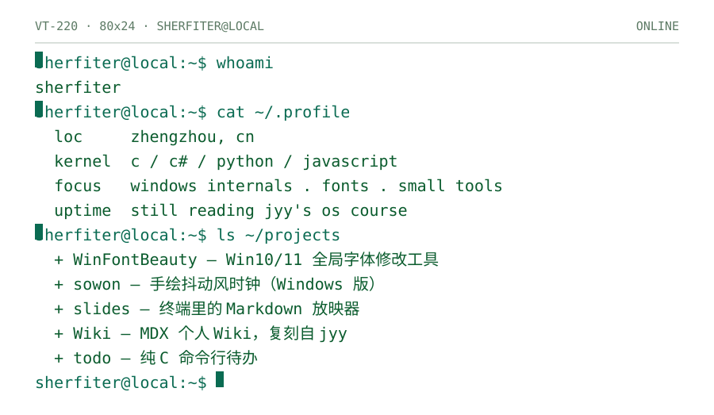

<picture>
  <source media="(prefers-color-scheme: dark)" srcset="https://raw.githubusercontent.com/Sherfiter/Sherfiter/main/assets/console-dark.svg">
  
</picture>

<a href="https://github.com/Sherfiter/WinFontBeauty">WinFontBeauty</a> · <a href="https://github.com/Sherfiter/sowon-personal-windows-verison">sowon</a> · <a href="https://github.com/Sherfiter/slides">slides</a> · <a href="https://github.com/Sherfiter/Wiki">Wiki</a> · <a href="https://github.com/Sherfiter/todo">todo</a>
